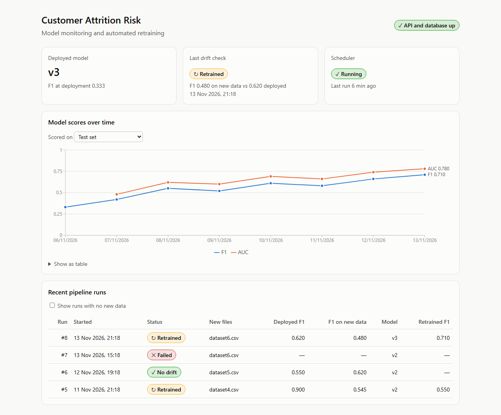
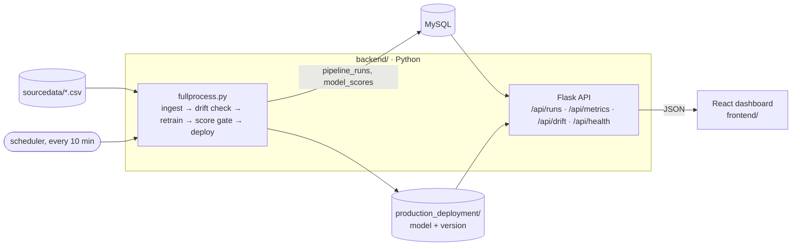

# Customer Attrition Risk: Model Monitoring and Automated Retraining

A small MLOps system that predicts which corporate clients are likely to leave,
watches the deployed model for drift, retrains and redeploys it automatically
when its score drops, and shows all of it on a live
[React](https://react.dev/) dashboard.



<sub>The dashboard with demo data. Source: [`frontend/`](frontend/).</sub>

## What it does

- **Ingests** new CSV files from a source folder, merges and de-duplicates them.
- **Checks for model drift.** It scores the deployed model on the new data and
  compares the result with the score the model had when it was deployed.
- **Retrains** a logistic regression model when that score drops, and **deploys
  it only if it scores at least as well** on the test data as the current model.
  Every deployment gets a version number (v1, v2, ...).
- **Logs every pipeline run to MySQL**: status, scores, drift decision and model
  version. Failed runs are logged too.
- **Serves a read-only JSON API** (Flask) that the dashboard polls every 30 seconds.

## Architecture



The frontend only talks to the API, and the API only reads what the pipeline
has recorded: it never trains, scores or writes anything.

## Tech stack

| Layer | Tools |
|---|---|
| Model and pipeline | Python, pandas, scikit-learn |
| Storage | MySQL (`mysql-connector-python`) |
| API | Flask, gunicorn |
| Dashboard | [React](https://react.dev/) 19, TypeScript, [Vite](https://vite.dev/), [Recharts](https://recharts.org/) |
| Tests | pytest |

## Dashboard API

| Endpoint | Returns |
|---|---|
| `GET /api/health` | API and database status, deployed model version |
| `GET /api/runs?limit=20&include_idle=0` | Most recent pipeline runs, newest first |
| `GET /api/metrics?limit=100` | F1 and AUC history, oldest first |
| `GET /api/drift` | Deployed model version and score, last drift check, last run |

The original endpoints (`/prediction`, `/scoring`, `/summarystats`,
`/diagnostics`) are still available in [`backend/app.py`](backend/app.py).

These endpoints have no authentication, and `/scoring` and `/diagnostics`
write files and retrain the model. That is why `app.py` listens on
`127.0.0.1` by default; set `FLASK_HOST=0.0.0.0` only on a trusted network.
`/prediction` only reads `.csv` files inside the test, ingested and source
data folders.

## Running it locally

You need Python 3.11+, Node.js 22+ and a MySQL server.

**1. Backend.** All backend commands run from the `backend/` folder.

```bash
cd backend
pip install -r requirements-dev.txt

# Database connection (these are the defaults)
export DB_HOST=localhost DB_PORT=3306 DB_USER=root DB_PASSWORD= DB_NAME=risk_system

python dbsetup.py       # create the database and tables
python fullprocess.py   # run the pipeline once
python app.py           # API on http://localhost:8000
```

**2. Dashboard**, in a second terminal:

```bash
cd frontend
npm install
npm run dev             # http://localhost:5173, /api is proxied to port 8000
```

**3. Tests:**

```bash
python -m pytest backend/tests
```

To run the pipeline on a schedule, see [`backend/cronjob.txt`](backend/cronjob.txt).

## Project structure

```
backend/
  ingestion.py, training.py, scoring.py, deployment.py   pipeline steps
  fullprocess.py     orchestrates a run and logs it to pipeline_runs
  dbsetup.py         MySQL schema, writes and read queries
  api.py             dashboard JSON API (/api/*)
  app.py             Flask app with the original endpoints
  tests/             API tests
frontend/
  src/api.ts         typed API client
  src/components/    drift panel, score chart, runs table
docs/                README images
```

## Limitations

The datasets are very small (26 training rows, 5 test rows), so the scores move a
lot between runs. On the 5-row test set the AUC can even be 0. The project is
about the monitoring and retraining loop, not about model accuracy.

## Acknowledgements

Built on the starter code from Udacity's *Machine Learning DevOps Engineer*
course ("A Dynamic Risk Assessment System"). The dashboard, the JSON API, run
logging, model versioning and the drift-check fixes were added on top of it.
See [`LICENSE`](LICENSE).
